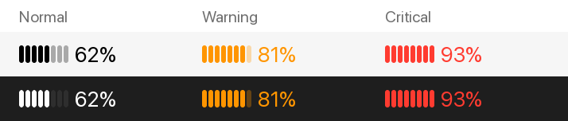
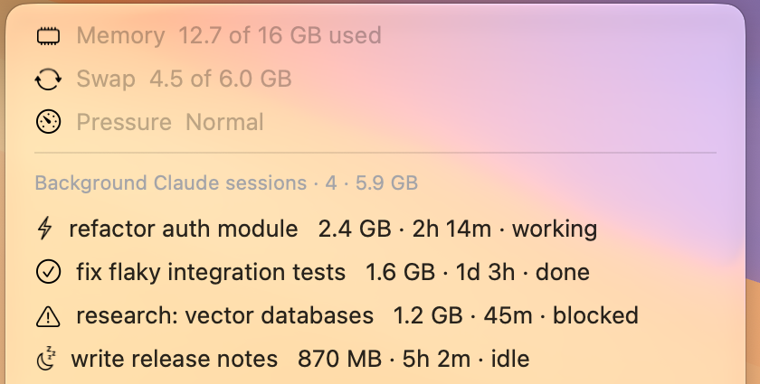

# FreeRAM

A macOS menu bar gauge for people who run Claude Code (the command-line tool) background sessions on a low-RAM Mac.

Background sessions keep running after you stop looking at them. Each one holds roughly 1 GB (the CLI plus its MCP servers) until it is stopped. On a 16 GB machine, four or five forgotten sessions push you into swap and everything slows down. A restart frees the memory only by killing everything. FreeRAM shows how full your memory is, which sessions are holding it, and lets you stop one with a click. The conversation is kept, so you can pick it up again later.





*Screenshot uses demo session names.*

## What it does

- **Menu bar:** a level meter and the percentage of RAM in use, measured the same way as Activity Monitor's "Memory Used" (app + wired + compressed). It turns orange when macOS reports memory pressure "Warning" and red at "Critical".
- **Menu:** memory, swap and pressure, then every background Claude Code session, largest first, with its size, age and state (working, done, blocked, idle).
- **Stop a session:** click it, confirm, and FreeRAM runs `claude stop <id>`. This frees its memory. The session stays in Claude Code's agent list, so you can open it again from there, or run `claude attach <id>`.
- **Safe by default:** interactive sessions (the ones open in a terminal) are never listed and are never stopped. Every stop asks first.
- **Accurate sizes:** each session's size includes its MCP server child processes, and uses macOS's physical footprint (from `top`), so GPU memory counts. `ps` RSS misses it.

It refreshes every minute and every time you open the menu.

## Requirements

- macOS 13 or later
- [SwiftBar](https://github.com/swiftbar/SwiftBar) (free, open source): `brew install --cask swiftbar`
- [Claude Code](https://claude.com/claude-code) with the `claude agents` command (tested on 2.1.305)
- Python 3, which ships with macOS (`/usr/bin/python3`). No packages to install.

## Install

1. Install and open SwiftBar, and pick a plugin folder when it asks.
2. Download the plugin into that folder:

   ```sh
   cd "$(defaults read com.ameba.SwiftBar PluginDirectory)"
   curl -fsSLO https://raw.githubusercontent.com/dazanza/FreeRAM/main/freeram.1m.py
   chmod +x freeram.1m.py
   ```

3. It appears in the menu bar within a few seconds. The `.1m` in the filename sets the one-minute refresh. Rename it to `freeram.5m.py` for every five minutes.

To start it at login, turn on SwiftBar's own "Launch at login" setting.

## Stop or remove

- Pause: click it, then **Disable Plugin**. Turn it back on with `open "swiftbar://enableplugin?name=freeram"`.
- Remove: delete `freeram.1m.py` from your SwiftBar plugin folder.

## Local MLX models

If you serve a local model with `mlx_lm.server`, its memory sits on the GPU. Activity Monitor's per-process view doesn't show it. While the server runs, a "Stop local MLX server" item appears with its size. Otherwise the item never shows.

## Test it

```sh
./freeram.1m.py --selftest                   # parser and safety checks
FREERAM_DEMO=1 ./freeram.1m.py               # sample sessions, for screenshots
FREERAM_DRY_RUN=1 ./freeram.1m.py stop <id>  # shows the dialog. Stop only prints the command
```

## License

MIT with the [Commons Clause](https://commonsclause.com/). You can use, change and share FreeRAM, including at work. You can't sell it, or sell a product or service whose value comes mainly from it. See [LICENSE](LICENSE).
